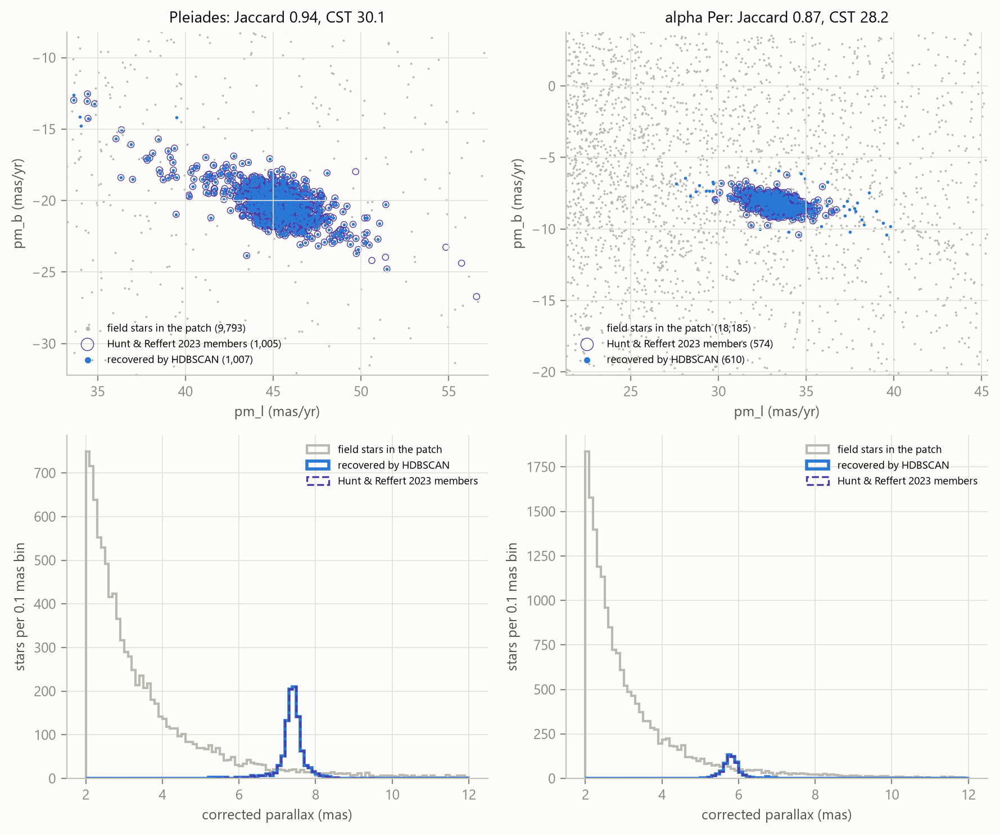
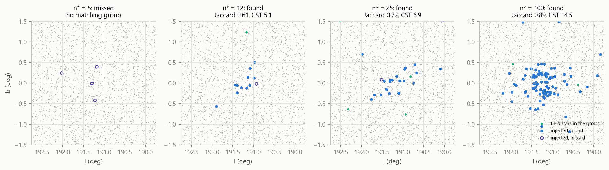
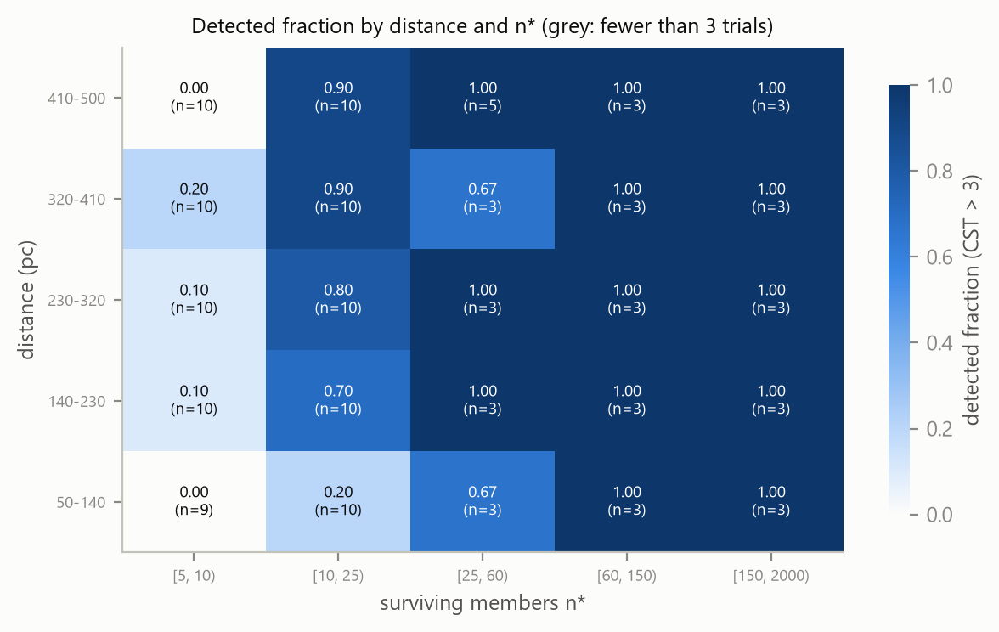
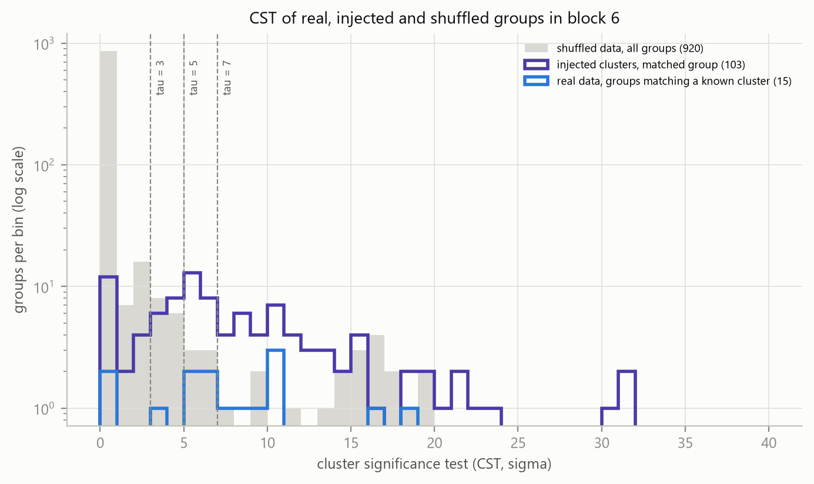

# How many stars does it take to find a cluster?

Date: 2026-10-16
Description: A pre-registered search for co-moving stars in Gaia DR3, and an honest measure of what it can and cannot see.
Canonical: https://shauryasharma.tech/how-many-stars.html

I set out to look for groups of stars moving together through space within about 500 parsecs of the Sun, using Gaia DR3. Finding a new group would have been nice. What I really wanted to know was something duller and more useful: if a group like that is out there, would my pipeline actually see it?

That second question turned into the whole project. Here's what I built, what it found, and the parts that didn't work.

The code, the pre-registration and every figure are in the repo: [github.com/Shaurya-34/Gaia](https://github.com/Shaurya-34/Gaia).

## Writing the rules down first

Before running anything on real data I wrote a pre-registration (`PREREG.md`, tagged `prereg-v1`). It fixes the cuts, the clustering settings, what counts as a detection, the false-positive budget and the success rule for every experiment. Whenever I changed something later, it went into a dated table at the bottom with the reason.

That sounds bureaucratic for a solo project. It turned out to matter, because several results below are not what I hoped for, and the pre-registration is what stops me from quietly moving the goalposts.

I also split the sky into twelve Galactic blocks: some for training, some for validation, some for testing, and one sealed block I never downloaded at all. In the end the project ran on a single block (block 6) on my laptop. Doing more needed cloud compute, and I decided to close the project at a scope I could finish rather than keep it open.

## The pipeline

Each star becomes five numbers: sky position (l, b), parallax and the two proper-motion components, robustly scaled. This is the feature space Hunt & Reffert used in 2021. HDBSCAN then looks for dense clumps at four minimum cluster sizes (10, 20, 40 and 80 stars), and each clump gets a cluster significance test (CST) score, using the version from the ocelot package (MIT licensed, vendored with attribution). A group counts as detected if its CST is above 3.

<figure class="gaia-sky" data-src="data/gaia.json" data-stars="assets/gaia-stars.bin">
  

    

      <button type="button" data-cluster="Pleiades" aria-pressed="true">Pleiades</button>
      <button type="button" data-cluster="alpha Per" aria-pressed="false">alpha Per</button>
    

    

      <button type="button" data-view="sky" aria-pressed="true">on the sky</button>
      <button type="button" data-view="motion" aria-pressed="false">in motion</button>
    

    <button type="button" class="gaia-btn" data-shuffle aria-pressed="false">shuffle motions</button>
  

  <canvas class="gaia-canvas" width="720" height="720" role="img" aria-label="Stars around the chosen cluster, plotted by sky position or by proper motion"></canvas>
  

  <figcaption>Every star that passed the cuts within three half-number radii of the cluster. On the sky the cluster barely stands out. Switch to motion and it collapses into a tight knot, because its stars share one velocity; from then on blue marks the group HDBSCAN found and violet rings the catalogue members it missed. Shuffle motions swaps proper motions between stars in the same patch of sky and parallax slice. That's the false-positive test further down, approximated here on a square grid.</figcaption>
  <noscript>
    
  </noscript>
</figure>

Getting the data was harder than the clustering. The Gaia archive kept returning HTTP 500 errors for the queries I needed, so I switched to downloading the bulk catalogue files one at a time and filtering them on the way in.

## Does it find clusters we already know?

This was the first gate. If the pipeline can't find the obvious clusters, nothing else matters. Membership overlap is measured as a Jaccard score against the Hunt & Reffert catalogue:

| Cluster | Jaccard | CST |
|---|---|---|
| Pleiades | 0.94 | 30.1 |
| alpha Persei | 0.87 | 28.2 |
| Hyades | 0.63 | 18.9 |

All three pass. The Hyades score is lower, which isn't surprising: it's so close that it covers a big patch of sky.

## Measuring what it can see

To measure sensitivity I injected fake clusters into real Gaia fields and checked whether the pipeline got them back. Each fake cluster has a Plummer density profile. Every fake star borrows its brightness, colour and errors from a real star nearby (a "twin"), and goes through the same quality cuts as the real data. I judge recovery against the stars that survive those cuts, not the number I injected.

The main run did 159 of these trials across four fields. It took about six hours. For the first 50 minutes or so each trial took around two minutes. Then the laptop ran out of memory and started swapping to disk, and trials took closer to seven and a half. The results are the same either way. It just taught me to run fewer workers.

<figure>
  
</figure>

The headline result: beyond 140 pc, a group needs about 10 to 11 surviving members to have an even chance of being detected. Groups with fewer than 5 surviving members were never found (0 of 12). Above about 60 members, everything was found.

The surprise was the nearest distance bin. Between 50 and 140 pc a group needs about 23 members for an even chance, roughly twice as many. Nearby clusters spread over a lot of sky, so in position space they don't look like a tight clump.

<figure class="gaia-trials" data-src="data/gaia.json">
  

    

      <button type="button" data-tau="3" aria-pressed="true">CST &gt; 3</button>
      <button type="button" data-tau="5" aria-pressed="false">&gt; 5</button>
      <button type="button" data-tau="7" aria-pressed="false">&gt; 7</button>
    

    

  

  <svg class="gaia-plot" viewBox="0 0 660 380" role="img" aria-label="Every injection trial plotted by distance and surviving members, marked found or missed, with the fitted and measured fifty percent lines"></svg>
  <figcaption>All 158 trials that count (one was discarded because a real cluster got into its group). Filled: found. Open: missed. The steps are where each distance bin crosses an even chance in the data; the straight line is the fitted model, which can't bend for the nearest bin. Hover or tap anywhere for the model's probability there.</figcaption>
  <noscript>
    
  </noscript>
</figure>

I fitted the pre-registered model to this: a logistic curve in the number of members, with terms for distance, parallax error and local star density. On 36 held-out trials it ranks well (AUC 0.92) but it's overconfident: the calibration slope is 0.51 where 1 would be right. A model with distance alone does almost as well, and the parallax-error and density terms are consistent with zero. The model also misses the nearby bump, because its distance term is a straight line. So the measured steps are the more honest summary, and the fitted line is a rough guide.

## The part that didn't work: false positives

To estimate false positives I shuffled the proper motions of real stars among stars at similar sky positions and parallaxes. This kills any real co-movement while keeping the density structure of the field. Then I ran the full search on the shuffled data, three shuffles per field, twelve searches in all. The shuffle button in the star figure above does the same to one patch. alpha Per keeps only about a third of its knot, but the Pleiades keep more than half: a cluster that close fills its own parallax slices, so the shuffle mostly trades motions between members. Groups like that leak into the null, so the false-positive count, if anything, runs high.

The budget I wrote down in advance was 1 false positive per million stars searched. What came out was 49 per million at CST 3, 31 at CST 5 and 24 at CST 7. No threshold comes close.

<figure class="gaia-cst" data-src="data/gaia.json">
  

    <label class="gaia-range">threshold <output>3.0</output>
      <input type="range" min="0" max="40" step="0.1" value="3">
    </label>
    

  

  <svg class="gaia-plot" viewBox="0 0 660 300" role="img" aria-label="CST scores of shuffled, injected and known-cluster groups, with a movable threshold"></svg>
  <figcaption>Every group's CST score: 920 from the shuffled searches, 103 matched to injected clusters, 15 matched to known clusters. Drag the threshold. Anything to its right counts as a detection; the budget allows less than one shuffled group past it, across 799,731 stars searched. That only happens past the dotted line at 19.7, where 8 of the 103 injected clusters and none of the 15 known ones are left.</figcaption>
  <noscript>
    
  </noscript>
</figure>

The real data does have more significant groups than the shuffled data: 39 above CST 3 in 4 real searches, against 39 in 12 shuffled ones, so roughly three times as many per search. Fifteen of the real groups match known clusters. But with this false-positive rate, a new group above CST 3 isn't a candidate I'd trust, and I'm not publishing a candidate list.

## Can a classifier do better than the CST?

The last experiment asked whether a small LightGBM classifier, trained on HDBSCAN's own outputs plus the CST, could separate injected groups from shuffled noise better than the CST alone. The pre-registered bar was 5 more points of precision at 80% recall, with a bootstrap interval that excludes zero.

On the validation set it gains 3.7 points, with an interval from -8.9 to +14.3. That doesn't pass, and the classifier leans almost entirely on the CST anyway. The test set gets scored exactly once, behind a lock file, and I haven't run it yet. Given the validation result I expect a null, and I'll report it as one.

There's also a caveat that limits what this experiment can say even if it had passed. The positives are injected clusters and the negatives are shuffled real data, so the classifier learns to tell injected from shuffled. That's not the same as telling real clusters from real noise.

## What I'd take away

The pipeline finds the known clusters and its sensitivity is now measured, at least in one patch of sky: roughly 10 surviving members beyond 140 pc, twice that closer in. It also produces too many false positives to trust a new detection at the thresholds I planned. All of this comes from one block of sky, and the held-out checks are held-out trials, not unseen sky.

None of that is the "new cluster" headline, but it's the result I set out to measure, and the pre-registration means I can't talk myself out of the bits I don't like.
